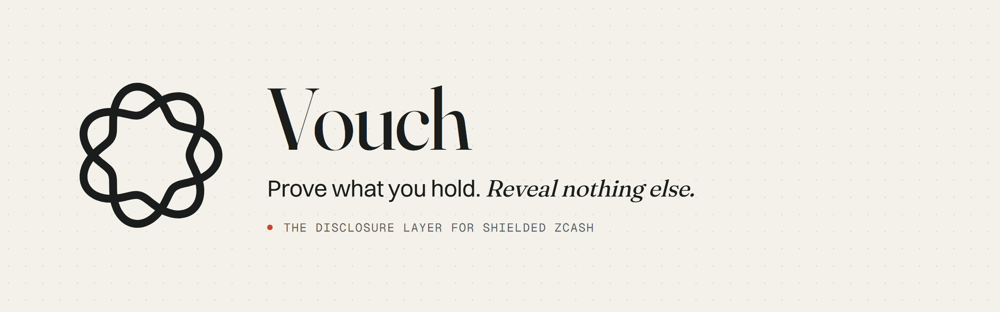
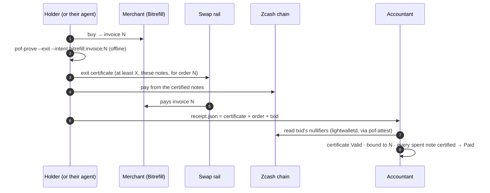
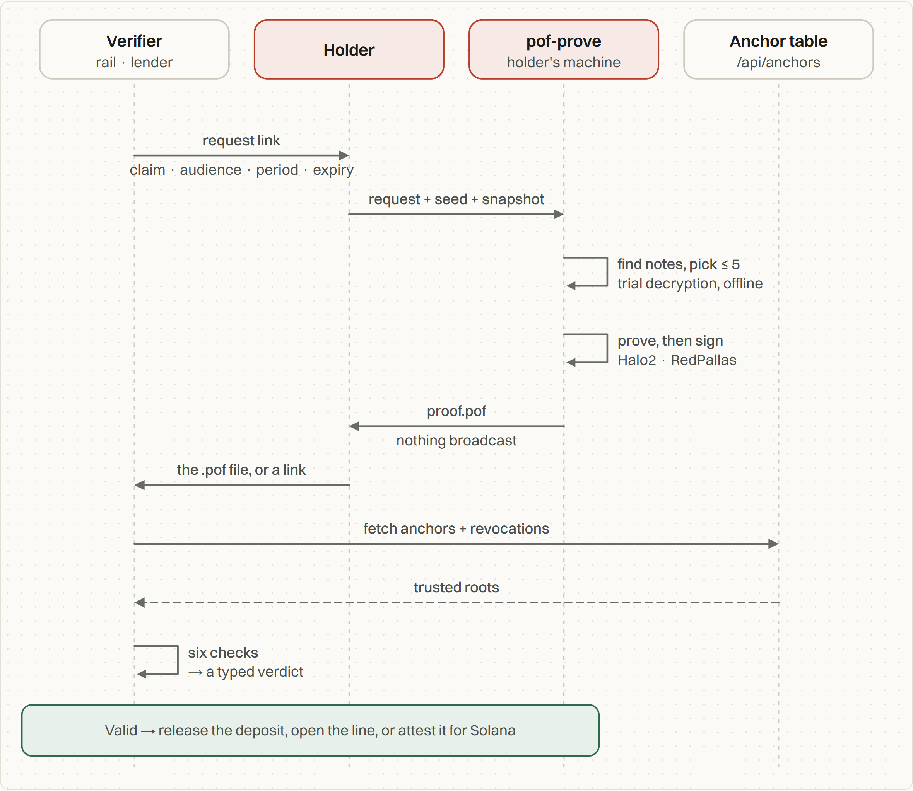
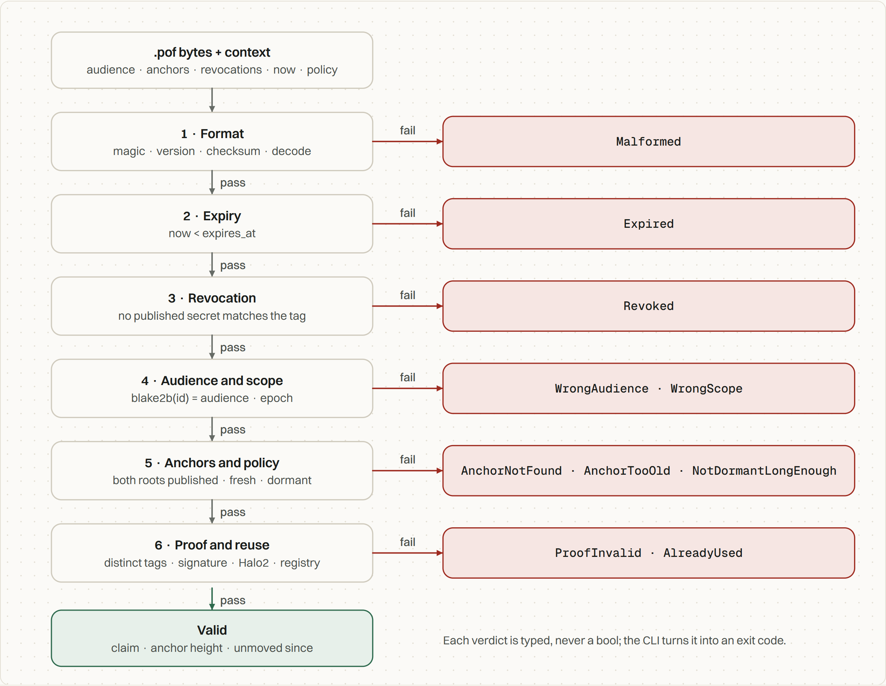
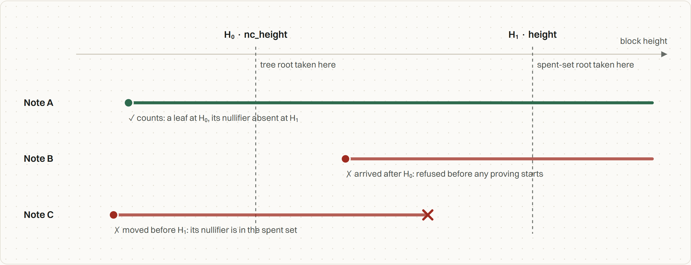
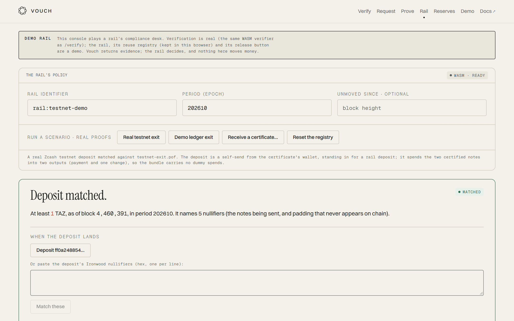
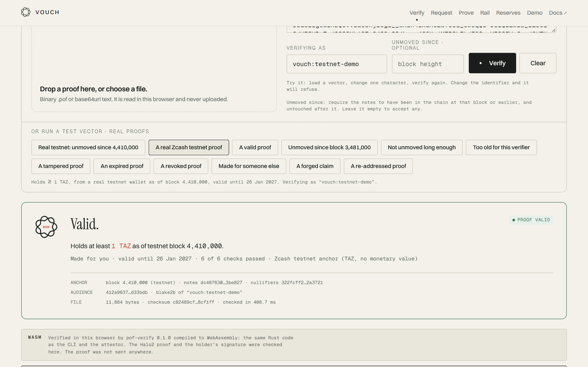
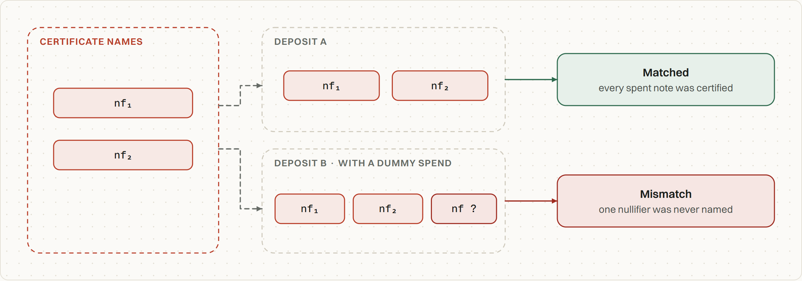
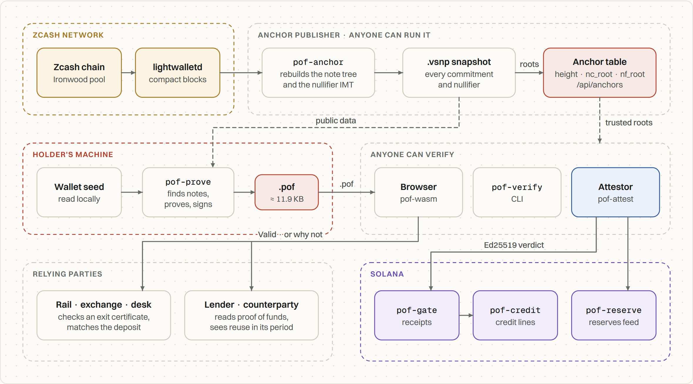
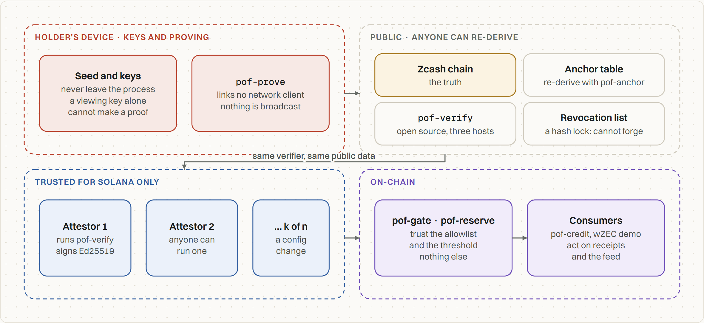

<p align="center">
  <picture>
    <source media="(prefers-color-scheme: dark)" srcset=".github/readme/banner-dark.png">
    
  </picture>
</p>

<p align="center">
  
  
  
</p>

<p align="center">
  <a href="https://vouch-zcash.vercel.app"><b>Live site</b></a> ·
  <a href="https://vouch-zcash.vercel.app/receipt"><b>Check a receipt</b></a> ·
  <a href="https://vouch-zcash.vercel.app/verify">Verify a real proof</a> ·
  <a href="https://vouch-zcash.vercel.app/rail">Rail console</a> ·
  <a href="agent/README.md">Shopping agent</a>
</p>

<p align="center">
  
</p>

## Venues ask for your viewing key. Vouch gives them one fact instead.

Shielded Zcash is private until the money has to go somewhere. At a swap rail, an exchange or an OTC desk, a large shielded deposit has no history to score, so it lands as “unknown”, and unknown deposits get held. To get the money released, the holder is asked for the only thing Zcash offers: a **viewing key**. A viewing key shows every note, amount and memo the wallet has ever received, to whoever holds it, for ever.

So privacy becomes a penalty, and the people who use it pay it. The choice today is **show nothing** (and stay held) or **show everything** (and stop being private).

**Vouch is the third option: show one fact.** A holder proves exactly one claim about their coins, to one named party, until one expiry, revocably, and nothing else:

| You need to show… | Today | With Vouch |
| --- | --- | --- |
| A rail that your deposit is not “unknown” | your viewing key | an **exit certificate**: *at least X ZEC, in notes already in the chain at block H and unmoved since, and these are the notes I am sending you* |
| A lender or counterparty that you can cover a deal | your viewing key | a **proof of funds**: *at least X ZEC*, to that verifier only, for one period |
| Your accountant or employer that you paid one order | your viewing key | a **Vouch Receipt**: *order N was paid by the holder of these notes* (**new**) |
| The public that a treasury is backed | your viewing key | a **reserves batch**: several proofs summed, no note counted twice |

Your AI shopping agent can now do the same: it buys through Bitrefill, pays from shielded ZEC, and gives you a receipt for each order, not your wallet (**new**).

The proof is a 12 KB `.pof` file: a Halo2 zero-knowledge proof over the Zcash chain’s own data, with no trusted setup. Anyone can check it against public roots in about 100 ms, in a browser, with a CLI or through an attestor. Nothing is bridged, nothing is locked, nothing is custodied. Only a proof moves.

> **Status, plainly:** a hackathon build. **Not audited. Testnet and a demo ledger only, no mainnet proofs yet.** See [Honest limits](#honest-limits).

---

## Contents

[At a glance](#at-a-glance) · [What’s new](#whats-new) · [Vouch Receipts](#new-vouch-receipts) · [Vouch Shopper agent](#new-vouch-shopper-an-agent-that-pays-privately) · [Never a dead end](#new-a-refusal-is-never-a-dead-end) · [How it works](#how-it-works) · [Why only Zcash](#why-this-only-works-on-zcash) · [The products](#the-products) · [Proof it works](#proof-it-works) · [Honest limits](#honest-limits) · [Running it](#running-it) · [Tests](#tests) · [Architecture](#architecture) · [Repo layout](#repo-layout) · [Trust model](#trust-model) · [Next](#next-30-day-milestone) · [Credits](#credits-and-licence)

## At a glance

| | |
| --- | --- |
| One line | Replace the viewing key with one fact: an exit cleared, an order paid, a balance shown, to one party, revocably. |
| For privacy | Makes private money the easy default at the exact moment it fails today (leaving the pool), without asking the user to reveal their wallet. The next builder gets a file format, a verifier that runs anywhere, and an HTTP API. |
| For agents | An agent that finds and buys through Bitrefill’s MCP tools, behind a human approval gate, pays from shielded ZEC, and leaves a per-order receipt that proves the purchase without exposing the wallet. |
| Try it in one minute | Open **[/receipt](https://vouch-zcash.vercel.app/receipt)** → *Real testnet payment* → **Paid.** Then *Edited order* → **Not this order.** |

## What’s new

| New | Where |
| --- | --- |
| **Vouch Receipts**: a new disclosure, *“order N was paid by the holder of these notes”*, with its format, five-check rules and refusal verdicts | [`frontend/src/lib/vouch-receipt.ts`](frontend/src/lib/vouch-receipt.ts) |
| The receipt check in the attestor, re-reading the payment from **lightwalletd** so the receipt’s own copy is never trusted: `POST /v1/receipts/verify` | [`backend/crates/pof-attest/src/receipt.rs`](backend/crates/pof-attest/src/receipt.rs) |
| The **`/receipt`** page: drop a receipt, get one answer, in the browser, plus “re-read the payment from the chain” | [`frontend/src/components/receipt/ReceiptConsole.tsx`](frontend/src/components/receipt/ReceiptConsole.tsx) |
| Personalised BLAKE2b in the browser, so it computes `intent_binding` exactly as Rust does (pinned by a test on the real testnet certificate) | [`frontend/src/lib/pof/blake2b.ts`](frontend/src/lib/pof/blake2b.ts), [`hash.ts`](frontend/src/lib/pof/hash.ts) |
| Receipt test vectors from the real testnet certificate and transaction, plus two tampered ones, and a runner | [`scripts/make-receipts.mjs`](scripts/make-receipts.mjs), [`scripts/verify-receipts.mjs`](scripts/verify-receipts.mjs), [`fixtures/receipts/`](fixtures/receipts) |
| **Vouch Shopper**, the agent: Claude + Bitrefill MCP + Vouch, with an approval gate on every purchase and a keyless `selftest` | [`agent/`](agent) |
| **Never a dead end**: every refusal in the rail console now says what to do next, ending with the viewing-key fallback | [`frontend/src/components/rail/RailConsole.tsx`](frontend/src/components/rail/RailConsole.tsx) |
| The re-pitch: freedom first, compliance second, Solana out of the headline | landing page, this README |

## New: Vouch Receipts

**The claim:** *order N was paid by whoever controls these shielded notes.* Shown to one party (an accountant, an employer reimbursing expenses, a merchant’s support desk). **Not shown:** the wallet, its balance, its addresses or any other payment.

**Why it needs no new circuit.** Vouch already has *exit certificates*: a proof, signed with the notes’ spend authority, that names the notes being sent by their nullifiers and is bound to one *intent*. A receipt is just that certificate bound to the order, kept together with the payment that spent those notes:



**The five checks**, cheapest first. The first failure decides the verdict:

| # | Check | Refusal |
| --- | --- | --- |
| 1 | The receipt parses, and the order id appears in the intent | `Malformed` |
| 2 | The certificate passes all six Vouch checks (format, expiry, revocation, audience and period, anchor, Halo2 proof and spend-authority signature) | `CertificateRefused` |
| 3 | It is an exit certificate (it names its notes) | `NotACertificate` |
| 4 | `blake2b("vouch-intent-v1", intent) == certificate.binding`: the holder signed for this order | `WrongOrder` |
| 5 | Every nullifier the payment reveals is one the certificate named | `NotPaidByCertifiedNotes` / `NoShieldedSpend` |

A receipt is about the past, so a certificate that has expired since is checked **as of the payment**, if the payment time falls inside its validity. Revocation still applies: a holder can withdraw a receipt by publishing the certificate’s revocation secret.

**What it proves and what it doesn’t.** It proves that the payer controls the certified notes and signed for this order before paying. It does not prove what the merchant delivered, and the price is as the merchant listed it. On the demo ledger, the payment’s nullifiers come from the receipt. On testnet and mainnet, the attestor reads them from lightwalletd.

**On real data, today:**

| Vector | What it is | Browser (WASM) | Attestor (lightwalletd) |
| --- | --- | --- | --- |
| `testnet-paid` | Real testnet certificate `testnet-exit.pof` + real transaction `ff0a2488…` (block 4,460,517) | `Valid` | `Valid` · `receiptAgrees: true` |
| `testnet-wrong-order` | The same, with the order id edited afterwards | `WrongOrder` | `WrongOrder` |
| `demo-paid` | Demo ledger | `Valid` | `Valid` |
| `demo-not-certified` | The payment also spends a note the certificate never named | `NotPaidByCertifiedNotes` | `NotPaidByCertifiedNotes` |

## New: Vouch Shopper, an agent that pays privately

An AI agent ([`agent/`](agent)) that turns “buy me a ₹500 Swiggy gift card” into a purchase, without ever touching a seed or a viewing key:

1. **Find.** It searches Bitrefill and reads the product through **Bitrefill’s MCP server** (`search-products`, `get-product-details`).
2. **Ask.** Before `buy-products`, the agent **stops and shows you the cart**. Nothing is bought without a *y*. The MCP client runs in the agent’s own process, not on the model provider’s side, so this gate cannot be skipped.
3. **Certify.** `vouch_certify` proves an exit certificate for the swap rail, bound to `bitrefill:invoice:<id>`, offline from your notes, and verifies it (≈350 ms) before anything is paid.
4. **Pay.** From the certified notes, through the rail. Bitrefill does not take ZEC directly (its listed methods are BTC, Lightning, ETH, SOL, LTC and stablecoins), so a rail turns shielded ZEC into the invoice payment. That is exactly the venue an exit certificate exists for.
5. **Receipt.** `vouch_settle` writes `receipt-<invoice>.json` and gets the attestor’s verdict. You hand that file to your accountant instead of a viewing key.

Model: any of Claude (`ANTHROPIC_API_KEY`) or an OpenAI-compatible API with tool calling (`LLM_API_KEY`): Google Gemini (free key), Groq, OpenRouter or OpenAI. Three ledgers, always labelled:

| `VOUCH_NETWORK` | Certificate | ZEC payment | Bitrefill invoice |
| --- | --- | --- | --- |
| `demo` (default) | a real proof over the demo chain | **simulated** (spends the first certified note) | real, created and **not paid by the demo coins**, said plainly |
| `testnet` | from your testnet wallet | you send TAZ and paste the txid; nullifiers read from lightwalletd | real, not settled by TAZ (no value) |
| `mainnet` | from your wallet | through a rail that takes shielded ZEC | paid by the rail |

`npm run selftest` runs the whole Vouch half with no API keys: certify → pay (demo) → receipt → attestor verdict `Valid`. Details: [`agent/README.md`](agent/README.md).

## New: a refusal is never a dead end

The obvious question is *“what if the certificate fails?”*. In the [rail console](https://vouch-zcash.vercel.app/rail), every refused certificate and every mismatched deposit now shows **what to do next**:

1. the specific fix: a fresh request for `Expired` / `AnchorTooOld` / `WrongScope` / `NotDormantLongEnough`, a transaction built from certified notes only for a mismatch, a hold for `AlreadyUsed`, a rejection for a forgery;
2. always, last: **the holder may share a viewing key.** That is today’s way, and the holder’s choice. Vouch narrows what has to be disclosed; it never removes the way out.

## How it works

<picture>
  <source media="(prefers-color-scheme: dark)" srcset=".github/readme/fig-lifecycle-dark.png">
  
</picture>

1. **The verifier asks.** A request is a link carrying the threshold, the verifier’s identifier, an expiry, and optionally a period and an “unmoved since” block. Nothing is stored on a server.
2. **The holder proves, offline.** `pof-prove` reads the request, a public chain snapshot and the holder’s seed. It trial-decrypts the holder’s Ironwood notes, picks up to five, builds a Halo2 proof and signs the statement with the notes’ spend authority. Before proving, it shows in plain language what the verifier will and will never learn. The prover library links no network client, and a test enforces it.
3. **Anyone verifies.** `pof-verify` runs six checks, cheapest first: format, expiry, revocation, audience and period, anchors and policy, then the proof itself. It returns a typed verdict. The same Rust code runs as a CLI, as WASM in the browser, and inside the attestor.
4. **Someone acts.** A rail releases a deposit, an accountant files a receipt, a lender opens a line.

<picture>
  <source media="(prefers-color-scheme: dark)" srcset=".github/readme/fig-pipeline-dark.png">
  
</picture>

### “Unmoved since block H”

The proof takes the note-commitment tree at one block and the spent-nullifier set at a later one. A note that was already a leaf at H₀, and whose nullifier is still absent at H₁, existed then and hasn’t moved since. Both roots were already independent public inputs, so this needed no circuit change, only a verifier rule.

<picture>
  <source media="(prefers-color-scheme: dark)" srcset=".github/readme/fig-dormancy-dark.png">
  
</picture>

## Why this only works on Zcash

- **The note-commitment tree is a clock.** It only grows, so “this note was a leaf at block H” is a permanent, public fact about the past.
- **The nullifier set is a “not moved” proof.** A note can only be spent by revealing its nullifier, which is also what lets a receipt tie a payment to a certificate.
- **Spend authority can be shown without spending.** A viewing key alone cannot make a proof, so a leaked viewing key cannot forge one.
- **The circuit already exists, and the community has used it.** Vouch uses the Ironwood delegation circuit from Valar Group’s [voting-circuits](https://github.com/valargroup/voting-circuits), the one the NU7 poll used, with one added constraint for “at least X”.

No association-set provider decides which coins are acceptable. The chain’s own history is the allow-list, and the verifier picks the block.

## The products

<table>
<tr>
<td width="50%" valign="top">

### Exit certificates

For swap rails, exchanges and desks. A second circuit also reveals the certified notes’ nullifiers. When the deposit lands, the rail reads the nullifiers it reveals and checks that every one was certified.

The real testnet deposit `ff0a2488…` → **Matched**.

</td>
<td width="50%"></td>
</tr>
<tr>
<td width="50%"></td>
<td width="50%" valign="top">

### Proof of funds

For lenders and counterparties. *At least X*, made for one verifier and one period. Scope tags make reuse visible to that verifier and unlinkable for everyone else. Revocable by publishing a secret.

A real testnet proof (≥ 1 TAZ at block 4,410,000), verified in the browser. The proof never leaves the tab.

</td>
</tr>
<tr>
<td width="50%" valign="top">

### Receipts *(new)*

For accountants, employers and support desks. *Order N was paid by the holder of these notes.* An exit certificate bound to the order, plus the payment that spent its notes. See [Vouch Receipts](#new-vouch-receipts).

</td>
<td width="50%" valign="top">

### Reserves

For treasuries and wrapped-ZEC issuers. A `.pofb` batch sums several proofs, and a note counted in two of them is refused. Demo batch: **4,018.125 ZEC across 3 proofs**. It works with other chains too: an attestor signs the total for a feed a token can only mint within.

</td>
</tr>
</table>

<picture>
  <source media="(prefers-color-scheme: dark)" srcset=".github/readme/fig-match-dark.png">
  
</picture>

## Proof it works

Everything below is real and reproducible. The Zcash artefacts are on **testnet**; there are no mainnet proofs.

**On Zcash testnet**

| What | Artefact | Result |
| --- | --- | --- |
| First real proof from a real wallet | `fixtures/proofs/testnet-valid.pof`: ≥ 1 TAZ at block 4,410,000 | `Valid`, natively and in WASM |
| “Unmoved since” | `fixtures/proofs/testnet-dormant.pof`: in the chain at 4,410,000, unspent at 4,459,000 | `Valid · unmoved since block 4410000` |
| A note that arrived too late | `testnet-dormant-too-young` | `NotDormantLongEnough` |
| Exit certificate | `fixtures/proofs/testnet-exit.pof`, anchor 4,460,391 | `Valid`, names its notes |
| The deposit | `ff0a2488543a58b852b22c426313ea00c00de1e79a6fa1710dc3cbae69ab256a`, spending exactly the certified notes | **`Matched`** |
| **The receipt** *(new)* | `fixtures/receipts/testnet-paid.json`: the certificate + that transaction, re-read from testnet lightwalletd | **`Valid`**, `receiptAgrees: true` |
| **An edited receipt** *(new)* | `fixtures/receipts/testnet-wrong-order.json` | `WrongOrder` |
| The first attempt | `testnet-exit-first-attempt`: the wallet added three dummy spends | `Mismatch`, kept as a documented finding |

**The agent** *(new)*: `npm run selftest` on a 12-core Windows laptop: certificate proven offline in about 8 s, verified in 351 ms, receipt `Valid` from the attestor.

<details>
<summary><b>On other chains (Solana devnet)</b></summary>
<br>

Chains that cannot read Zcash take a signed verdict from an attestor. The live end-to-end test (`scripts/e2e.mjs`) passes **26 of 26 checks** against https://vouch-zcash.vercel.app: proof → attestation → on-chain receipt → a 25,000 dUSDC credit line → a 1,000 dUSDC draw, with replay, a stranger’s wallet, a tampered attestation, a tampered proof and a revoked proof each refused; a reserves batch published to a feed, a double-counted batch refused, and a mint past the proven reserves refused. Programs: `pof-gate` [`A6WmRTgE…Xn8C`](https://explorer.solana.com/address/A6WmRTgEAHC9GHstaj9oD8woVNRw9jgu31bpKVREXn8C?cluster=devnet), `pof-credit` [`J6ewFZAz…yra1`](https://explorer.solana.com/address/J6ewFZAzcTkbVsYNBrcZvzdBtTTUK5UrpqCg9jiNyra1?cluster=devnet), `pof-reserve` [`5Q26Tjcd…35h9`](https://explorer.solana.com/address/5Q26Tjcd4equ5te5hF15eG4xK6uvkbZtKkEeqdf535h9?cluster=devnet).

</details>

## Honest limits

- **Not audited. Testnet and demo ledger only.** There is a mainnet anchor (block 3,493,000, matching lightwalletd’s roots), but no mainnet proof yet.
- **The shopping agent’s ZEC leg is simulated on the demo ledger.** The Bitrefill invoice is real; it is not paid by demo coins. On testnet you send the TAZ yourself and paste the txid. There is no live ZEC → stablecoin rail wired in yet (NEAR Intents is the obvious one).
- **A receipt proves who paid, not what was delivered.** The price on a receipt is as the merchant listed it, and is not proven.
- **The prover downloads the public chain snapshot** (tens of MB) to build its witnesses. That is fine on a laptop, but not yet on a phone. A bucketed witness server is on the roadmap.
- **The nullifier tree root is rebuilt by Vouch from compact blocks.** It has not yet been cross-checked against a root published by the NU7 round itself.
- **Wallets must build exit transactions without dummy spends**, or a deposit reads as a mismatch. That was found on testnet and is documented, not hidden.
- **The attestor is trusted only by chains that cannot read Zcash.** Every verdict it signs can be re-derived from public data by anyone.

## Running it

**The site** (in-browser verifier, receipts, rail console; committed WASM and fixtures):

```bash
cd frontend && pnpm install && pnpm dev          # http://localhost:3000/receipt
```

**The attestor**, which re-reads receipts’ payments from lightwalletd:

```bash
cd backend && cargo build --release -p pof-attest -p pof-prove -p pof-verify
node -e "const f=n=>require('../fixtures/anchors.'+n+'.json');require('fs').writeFileSync('target/anchors.json',JSON.stringify([...f('mainnet'),...f('testnet'),...f('demo')]))"
POF_ANCHORS=target/anchors.json target/release/pof-attest          # :8787
curl -s localhost:8787/v1/receipts/verify -H 'content-type: application/json' \
  -d "{\"receipt\": $(cat ../fixtures/receipts/testnet-paid.json)}"
# {"verdict":{"kind":"Valid","spent":2},"chain":{"source":"lightwalletd","height":4460517,"receiptAgrees":true,…}}
```

Point the site at it with `POF_ATTEST_URL=http://localhost:8787` to enable *Re-read the payment from the chain* on `/receipt`.

**The agent:**

```bash
cd agent && npm install
npm run selftest                                         # no keys: certify → pay (demo) → receipt → Valid
export BITREFILL_API_KEY=…                               # bitrefill.com/account/developers
export LLM_API_KEY=…                                     # a free Gemini key: aistudio.google.com/apikey
#   (or LLM_PROVIDER=groq|openrouter|openai with that key, or ANTHROPIC_API_KEY for Claude)
npm start -- "Buy a 500 INR Swiggy gift card"            # asks before every purchase
```

**Prove with your own wallet** (testnet shown; drop `--network testnet` for mainnet):

```bash
cd backend
cargo run --release -p pof-anchor -- scan --network testnet          # lightwalletd → snapshot + anchor
../scripts/sync-fixtures.sh                                          # publish the anchor to the site
cargo run --release -p pof-prove -- prove --request '<link from /request>' \
  --snapshot target/snapshots/testnet-<h>.vsnp --seed-file ~/seed.txt --out proof.pof
# --since <H> for "unmoved since"  ·  --exit --intent <order> for an exit certificate or a receipt  ·  --batch-size 5 for reserves
```

Deploy: [`render.yaml`](render.yaml) runs the attestor on Render, and the site goes on Vercel with root `frontend/`. Details are in [`backend/README.md`](backend/README.md) and the [docs](https://vouch-zcash.vercel.app/docs/attestor).

## Tests

| Command | What it checks |
| --- | --- |
| `node --no-warnings scripts/verify-receipts.mjs` *(new)* | Every receipt vector through the site’s receipt checker, backed by the native verifier: 2 `Valid`, `WrongOrder`, `NotPaidByCertifiedNotes` |
| `cargo test --release -p pof-attest` *(new tests)* | The receipt rules, and `intent_binding` pinned on the real testnet certificate’s binding |
| `cd agent && npm run selftest` *(new)* | The agent’s Vouch half end to end, keyless |
| `cargo test --release --workspace` (in `backend/`) | Format, every vector through the native verifier, embedded keys, IMT, the no-network invariant |
| `cargo test --release -p pof-zk --features prove --test roundtrip -- --ignored` | Real proofs: threshold, dormancy, every tamper case, one note counted five times refused |
| `pnpm test:fixtures` · `pnpm test:wasm` (in `frontend/`) | The TypeScript codec equals the Rust encoder; the committed WASM equals native on every vector, and every result matches [the JSON Schema](frontend/public/schema/pof-v1.json) |
| `pnpm typecheck` (in `frontend/` and `agent/`) | Types |

## Architecture

<picture>
  <source media="(prefers-color-scheme: dark)" srcset=".github/readme/fig-system-dark.png">
  
</picture>

| Component | Role | Network |
| --- | --- | --- |
| `pof-core` | The `.pof` / `.pofb` format: types, codec, checksum, statement, signing and intent hashes | none |
| `pof-zk` | Circuit glue: embedded verifying keys, `verify_holding`, refuses repeated tags before Halo2 | none |
| `pof-verify` | The verifier and its CLI: `verify`, `verify_batch`, `exit_matches` | none |
| `pof-wasm` | `pof-verify` for the browser, about 4.6 MB, committed so CI tests exactly what ships | none |
| `pof-prove` | The holder’s library and CLI: requests, note discovery, proving, history, revocation | library: none (enforced) |
| `pof-anchor` | Rebuilds the note tree and nullifier IMT from compact blocks; snapshots; publishes anchors | lightwalletd (gRPC) |
| `pof-attest` | HTTP service: verify, the rail API, **receipts**, reserves, signed verdicts for other chains | lightwalletd, optional RPC |
| `agent/` *(new)* | Vouch Shopper: a model with tool calling + Bitrefill MCP + `pof-prove` / `pof-verify` | the model’s API, Bitrefill MCP |
| `frontend/` | Next.js 15: verifier, request builder, prover console, rail console, **receipts**, reserves, docs | the attestor |

The circuit is the vendored voting-circuits delegation circuit with two marked changes: **the threshold** (a 15th public input and the constraint `num_ballots − min_ballots ∈ [0, 2³⁰)`), and **circuit 2** for exit certificates (a reveal flag plus five revealed nullifiers, with its own verifying key). Receipts added **no** circuit change.

## Repo layout

```
agent/               Vouch Shopper (new): src/index.ts (the loop + Bitrefill MCP), src/models.ts (Claude or OpenAI-compatible), src/vouch.ts (certify, pay, receipt)
backend/
  crates/
    pof-core/        the .pof / .pofb format, hashes, codec
    pof-zk/          circuit glue, embedded params + verifying keys
    pof-verify/      the verifier + pof-verify CLI          ← the single source of verdicts
    pof-prove/       the holder's library + pof-prove CLI    ← links no network client
    pof-anchor/      snapshots, root rebuild, pof-anchor CLI (lightwalletd)
    pof-attest/      the attestor: verify, rail API, receipts (new: receipt.rs), reserves
    pof-wasm/        the verifier for the browser
  solana/            programs for chains that cannot read Zcash
  vendor/            voting-circuits & co., Vouch changes marked (VOUCH-MODIFICATIONS.md)
frontend/            Next.js 15
  src/app/(site)/    verify · request · prove · rail · receipt (new) · reserves · demo · landing
  src/lib/vouch-receipt.ts   the receipt format and rules (new)
  public/receipts/   receipt test vectors served to /receipt (new)
fixtures/            real proofs + expected verdicts, anchor tables, the demo ledger, receipts (new)
scripts/             make-receipts · verify-receipts (new) · build-wasm · sync-fixtures · verify-fixtures-wasm · e2e
```

## Trust model

<picture>
  <source media="(prefers-color-scheme: dark)" srcset=".github/readme/fig-trust-dark.png">
  
</picture>

Everything a verifier relies on is public and re-derivable. A wrong anchor-table entry can only make honest proofs fail; it cannot make a false one pass. The agent holds no keys: proving runs in `pof-prove` on the holder’s machine, and the agent sees only file paths and verdicts. Bitrefill’s tools are called from the agent’s own process, so a purchase cannot happen without the approval prompt. The full threat model is in the [docs](https://vouch-zcash.vercel.app/docs/threats).

## Design choices worth one line each

**The proof is a file, not an API call.** Offline verification, a testable boundary, and a format that can outlive any implementation of it.

**One verifier, compiled three ways, checked equal in CI.** The CLI, the browser and the attestor can never disagree about a verdict, because they’re the same function.

**A receipt re-reads the chain rather than trusting itself.** The attestor takes the payment’s nullifiers from lightwalletd by txid and says whether the receipt’s copy agrees.

**Reuse is visible per scope, not in a global registry.** The same notes give the same tag to one verifier in one period, and unrelated tags to everyone else.

**Every refusal comes with a next step.** The fallback to a viewing key stays, and it is the holder’s choice.

**Demo, testnet and simulated are said wherever they apply.** Including in the agent’s own summary.

## Next: 30-day milestone

One milestone, to agree with a wallet partner:

> **“Prove for exit” in a real wallet:** a wallet button that makes an exit certificate for a rail’s request link and builds the deposit from the certified notes only (no dummy spends), plus one mainnet certificate and receipt, verified on `/verify` and `/receipt`.

Stretch goals, in order: a pilot with one swap rail on its held-deposit queue; a NEAR Intents route so the agent pays Bitrefill from shielded ZEC on mainnet; a bucketed witness server so proving works on a phone.

## Credits and licence

The holding proof is the delegation circuit from Valar Group’s [voting-circuits](https://github.com/valargroup/voting-circuits), driven the way Chainapsis’s [zcash_voting](https://github.com/chainapsis/zcash_voting) drives it, over the Zakura Orchard/Ironwood crates. Vouch’s changes are listed line by line in each vendored crate’s `VOUCH-MODIFICATIONS.md` and in [THIRD-PARTY.md](THIRD-PARTY.md). Bitrefill’s MCP server and catalog power the agent.

MIT OR Apache-2.0, at your option. Vendored crates keep their own licences.
